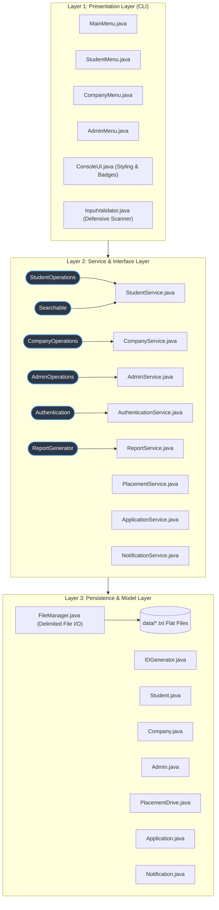

<div align="center">

# 🎓 PLACEMENT PRO
### *Smart Campus Recruitment & Placement Management System*

[](https://www.oracle.com/java/)
[](#-system-architecture)
[-success?style=for-the-badge)](https://docs.oracle.com/javase/8/docs/api/)
[](LICENSE)
[](#-quick-start)

<p align="center">
  <b>A production-grade, role-based campus recruitment portal built from the ground up in pure Core Java.</b><br>
  Demonstrates Object-Oriented Programming, Interface-Driven Architecture, Java Collections Framework, Custom Exception Handling, and File-Based Persistence.
</p>

[Explore Features](#-key-features-by-role) •
[Java Concepts](#-deep-dive-core-java-concepts) •
[Collections Architecture](#-collections-framework-matrix) •
[Quick Start](#-quick-start) •
[Team Contributions](#-four-member-collaboration-matrix)

</div>

---

## 📌 Executive Summary

**PLACEMENT PRO** is a zero-dependency, multi-role campus recruitment management system designed to eliminate manual spreadsheet tracking, prevent biased recruitment evaluations, and automate candidate qualification checks. 

Engineered strictly according to modern **Core Java** academic benchmarks, it features:
- **Zero Third-Party Frameworks**: Runs natively with just a standard JDK (no Spring Boot, Hibernate, MySQL, or JavaFX overhead).
- **Automated Eligibility Engine**: Instant validation of candidate CGPA, active backlog thresholds, and academic branch prerequisites.
- **Career Diagnostics**: Dynamic **Resume Readiness Scoring (0–100)** and real-time **Skill-Gap Analysis** against live corporate job descriptions.
- **Enterprise-Style Persistence**: Robust delimited flat-file engine with automated directory initialization and realistic seed data generation.

---

## 🚀 Key Features by Role

```text
+-----------------------------------------------------------------------------------+
|                                   PLACEMENT PRO                                   |
+-------------------------+-------------------------+-------------------------------+
|     STUDENT PORTAL      |     COMPANY PORTAL      |      ADMINISTRATOR PORTAL     |
+-------------------------+-------------------------+-------------------------------+
| • Profile & Skills Mgmt | • Post Placement Drives | • Campus-wide Oversight       |
| • Eligible Drive Filter | • Candidate Dossiers    | • CGPA / Package Sorting      |
| • Duplicate-Safe Apply  | • Shortlist / Select    | • Account & Drive Governance  |
| • Skill-Gap Analysis    | • Rejection Feedback    | • Live Placement Analytics    |
| • Resume Readiness Bar  | • Instant Notification  | • Exportable Dossier Reports  |
+-------------------------+-------------------------+-------------------------------+
```

### 👨‍🎓 1. Student Module
- **Smart Registration & Profile**: Validates CGPA (0.0–10.0), backlog count, branch, contact number, and skills.
- **Eligibility Engine**: Automatically filters and displays only those drives where the student meets minimum CGPA, maximum backlogs, and branch criteria.
- **Search Capabilities**: Find drives by company name, job role, or work location.
- **Application Engine**: Apply with single-key submission; prevents duplicate applications using $O(1)$ composite set hashing.
- **Resume Readiness Scoring**: Transparent 100-point algorithm evaluating academic performance, technical skills depth, and backlog-free status.
- **Skill-Gap Analysis**: Direct comparison between student technical skills and drive requirements, highlighting matched skills, missing skills, match percentage, and targeted study advice.
- **Notifications Inbox**: Real-time alerts for application shortlisting, selections, and college announcements.

### 🏢 2. Company / Recruiter Module
- **Recruiter Onboarding**: Register company profile, industry classification, headquarters, and HR contact.
- **Drive Authoring**: Set job role, CTC compensation (LPA), minimum CGPA, allowed backlogs, eligible branches, required skills, and deadlines.
- **Candidate Dossier Review**: Inspect complete student profiles, academic histories, verified skills, and contact data.
- **Status Lifecycle Pipeline**: Advance candidates through `APPLIED` &rarr; `SHORTLISTED` &rarr; `SELECTED` or `REJECTED` with custom interview feedback remarks.
- **Auto-Notifications**: Candidate is automatically notified the instant their status updates.

### 🛡️ 3. Administrator Module
- **System-Level Control**: View all students, companies, published drives, and active applications.
- **Multi-Criteria Comparator Sorting**: Sort students by CGPA descending or name; sort drives by CTC package descending or CGPA cutoff.
- **Search & Filter**: Search student database by branch or individual technical skill.
- **Drive & Account Governance**: Toggle drive active/inactive status and remove invalid accounts with cascade safety.
- **Real-Time Analytics**: Live computation of placement conversion rate, average/highest CTC packages, and recruitment funnel stages.
- **Report Exporter**: Generate and export formatted text dossiers to `reports/placement_summary_report.txt`.

---

## 🏗️ System Architecture

PLACEMENT PRO follows a decoupled **3-Tier Architecture**:



---

## ☕ Deep-Dive: Core Java Concepts

### 1. Object-Oriented Programming (OOP)
```
                                 [ User ] (Abstract Parent)
                                    ▲
          ┌─────────────────────────┼─────────────────────────┐
          │                         │                         │
     [ Student ]               [ Company ]                 [ Admin ]
(CGPA, Branch, Skills)    (Industry, Location, HR)   (Department, Security)
```
- **Inheritance & Abstraction**: Common user attributes (`id`, `name`, `email`, `password`, `role`) encapsulated inside abstract `User`.
- **Polymorphism**: Abstract method `getDisplaySummary()` is overridden uniquely by `Student`, `Company`, and `Admin`.
- **Encapsulation**: Strict private member variables with validated getters, setters, and state mutations.

### 2. Interface-Driven Design
Every business module is decoupled using pure Java interfaces:
- `interfaces.StudentOperations` &rarr; Implemented by `StudentService`
- `interfaces.CompanyOperations` &rarr; Implemented by `CompanyService`
- `interfaces.AdminOperations` &rarr; Implemented by `AdminService`
- `interfaces.Authentication` &rarr; Implemented by `AuthenticationService`
- `interfaces.Searchable` &rarr; Implemented by `StudentService`
- `interfaces.ReportGenerator` &rarr; Implemented by `ReportService`

### 3. Custom Exception Hierarchy
PLACEMENT PRO never crashes on invalid data. It incorporates domain-specific checked exceptions:
- `InvalidLoginException`: Mismatched credentials or unknown accounts.
- `UserAlreadyExistsException`: Prevents duplicate email registration across roles.
- `DriveNotFoundException`: Handles closed or invalid drive IDs.
- `AlreadyAppliedException`: Guards against duplicate application spamming.
- `InvalidInputException`: Validates numeric ranges, telephone formats, and emails.

---

## 📊 Collections Framework Matrix

| Collection | Implementation | Role in PLACEMENT PRO | Code Snippet / Justification |
| :--- | :--- | :--- | :--- |
| **`List<T>`** | `ArrayList<T>` | Interface-based primary storage for users, drives, applications, and notifications. | `List<Student> list = new ArrayList<>();`<br>*Enables dynamic expansion and index-based iteration.* |
| **`Map<K, V>`** | `HashMap<K, V>` | Fast $O(1)$ lookups for email-to-user credentials, ID lookups, and drive retrieval. | `Map<String, User> emailMap = new HashMap<>();`<br>*Eliminates sequential search loops during login.* |
| **`Set<T>`** | `HashSet<T>` | Eliminates duplicate skills, duplicate branches, and duplicate applications. | `Set<String> appliedKeys = new HashSet<>();`<br>*Stores composite key `studentId + "#" + driveId`.* |
| **`Set<T>`** | `TreeSet<T>` | Maintains naturally sorted technical skills and branch lists alphabetically. | `return new TreeSet<>(this.skills);`<br>*Keeps skills organized for recruiters without sorting overhead.* |
| **`Comparator<T>`**| Anonymous / Lambda | Custom multi-column sorting for CGPA, Package (LPA), and alphabetical order. | `students.sort((s1, s2) -> Double.compare(s2.getCgpa(), s1.getCgpa()));`<br>*Sorts candidate rosters dynamically.* |

---

## 📁 Repository Structure

```text
PLACEMENT-PRO/
├── .gitignore                     # Ignores .class, bin/, and local IDE caches
├── compile.bat                    # Windows one-click compile script
├── run.bat                        # Windows one-click run script
├── compile.sh                     # Linux / macOS compile script
├── run.sh                         # Linux / macOS run script
├── README.md                      # Project documentation dossier
│
├── data/                          # Auto-initialized persistent flat files
│   ├── admins.txt                 # Administrative credentials
│   ├── applications.txt           # Application statuses & timestamps
│   ├── companies.txt              # Recruiter profiles
│   ├── drives.txt                 # Active & inactive placement drives
│   ├── notifications.txt          # Dispatched user notifications
│   └── students.txt               # Student profiles & technical skills
│
├── reports/                       # Generated output directory
│   └── placement_summary_report.txt
│
├── screenshots/
│   └── walkthrough.txt            # Complete evaluation walkthrough transcript
│
└── src/
    ├── Main.java                  # Application bootstrap entry point
    │
    ├── cli/                       # Presentation Layer
    │   ├── AdminMenu.java
    │   ├── CompanyMenu.java
    │   ├── MainMenu.java
    │   └── StudentMenu.java
    │
    ├── exceptions/                # Domain Exception Hierarchy
    │   ├── AlreadyAppliedException.java
    │   ├── DriveNotFoundException.java
    │   ├── InvalidInputException.java
    │   ├── InvalidLoginException.java
    │   └── UserAlreadyExistsException.java
    │
    ├── interfaces/                # Business Contracts
    │   ├── AdminOperations.java
    │   ├── Authentication.java
    │   ├── CompanyOperations.java
    │   ├── ReportGenerator.java
    │   ├── Searchable.java
    │   └── StudentOperations.java
    │
    ├── models/                    # Data Entities
    │   ├── Admin.java
    │   ├── Application.java
    │   ├── Company.java
    │   ├── Notification.java
    │   ├── PlacementDrive.java
    │   ├── Student.java
    │   └── User.java
    │
    ├── services/                  # Business Logic & Algorithms
    │   ├── AdminService.java
    │   ├── ApplicationService.java
    │   ├── AuthenticationService.java
    │   ├── CompanyService.java
    │   ├── NotificationService.java
    │   ├── PlacementService.java
    │   ├── ReportService.java
    │   └── StudentService.java
    │
    └── utils/                     # Cross-Cutting Utilities
        ├── ConsoleUI.java
        ├── FileManager.java
        ├── IDGenerator.java
        └── InputValidator.java
```

---

## ⚡ Quick Start

### Prerequisites
- **Java Development Kit (JDK 8 or higher)** installed.
- Verify installation by running:
  ```bash
  javac -version
  java -version
  ```

### 📥 Clone Repository
```bash
git clone https://github.com/Zoid01-c/placement-pro-campus-recruitment-system.git
cd placement-pro-campus-recruitment-system
```

### 💻 Windows Setup
```cmd
# 1. Compile all source files into bin/
compile.bat

# 2. Run the application
run.bat
```

### 🐧 Linux / macOS Setup
```bash
# 1. Grant execution permissions
chmod +x compile.sh run.sh

# 2. Compile sources
./compile.sh

# 3. Launch application
./run.sh
```

*(Note: If running in a legacy terminal without ANSI color support, launch with: `java -cp bin Main --no-color`)*

---

## 🔑 Preloaded Demonstration Accounts

The application automatically seeds realistic records on its first execution:

| Role | Username / Email | Password | Academic / Corporate Details |
| :--- | :--- | :--- | :--- |
| **Administrator** | `admin@placementpro.com` | `Admin@123` | Chief Placement Officer, T&P Cell |
| **Student (CS)** | `rahul.sharma@college.edu` | `pass123` | CGPA: 8.85, 0 Backlogs, Java/Spring/SQL |
| **Student (IT)** | `priya.patel@college.edu` | `pass123` | CGPA: 9.20, 0 Backlogs, Python/AWS/ML |
| **Student (CS Top)** | `sneha.k@college.edu` | `pass123` | CGPA: 9.45, Selected at Google India |
| **Company** | `recruit@google.com` | `pass123` | Google India (Campus SDE: 28.5 LPA) |
| **Company** | `careers@microsoft.com` | `pass123` | Microsoft IDC (SDE-1: 24.0 LPA) |
| **Company** | `campus@tcs.com` | `pass123` | TCS Digital (Systems Eng: 7.5 LPA) |
| **Company** | `recruitment@infosys.com` | `pass123` | Infosys Technologies (Specialist: 9.5 LPA) |

---

## 🖥️ Terminal Interface Previews

<details>
<summary><b>Click to expand CLI Screenshots</b></summary>

### 1. Main Portal Gateway
```text
+================================================================+
|             PLACEMENT PRO - RECRUITMENT MANAGEMENT             |
+================================================================+
              Welcome to Placement Pro
     Your Career. Your Opportunity. Your Future.
------------------------------------------------------------------
  SELECT PORTAL:
    [1] Student Portal        (Browse drives, apply & gap analysis)
    [2] Company Portal        (Post drives, review candidates & shortlist)
    [3] Administrator Portal  (System statistics, drives & accounts)
    [4] About Project & Training Highlights
    [0] Exit Application
------------------------------------------------------------------
```

### 2. Student Dashboard & Resume Readiness Bar
```text
+================================================================+
|               STUDENT DASHBOARD - PLACEMENT PRO                |
+================================================================+
  Welcome, Rahul Sharma
  Student ID      : STU1001
  Branch          : Computer Science
  CGPA            : 8.85 / 10.0
  Active Backlogs : 0
  Notifications   : 2 Unread
  Progress: [#######################--] 94/100
------------------------------------------------------------------
```

### 3. Skill-Gap Analysis Engine
```text
--- SKILL-GAP ANALYSIS ---------------------------------------
  ANALYSIS FOR: Google India (Software Engineer - Campus)
  Required Skills : Distributed Systems, Java, SQL, System Design
  Your Skills     : Docker, Git, Java, SQL, Spring Boot
------------------------------------------------------------------
  Matching Skills (2): Java, SQL
  Missing Skills  (2): Distributed Systems, System Design

  Progress: [############-------------] 50/100

  Personalized Improvement Recommendations:
   * Acquire fundamental knowledge and projects in: Distributed Systems
   * Acquire fundamental knowledge and projects in: System Design
```

### 4. Recruiter Candidate Evaluation Roster
```text
--- APPLICANTS BY PLACEMENT DRIVE -----------------------------
  App ID     | Student ID | Candidate Name       | Status           | Applied On  
------------------------------------------------------------------
  APP4001    | STU1001    | Rahul Sharma         | [* SHORTLISTED]  | 2026-11-01  
    |-> Remarks: Cleared preliminary online coding assessment.
  APP4002    | STU1006    | Sneha Kulkarni       | [+ SELECTED]     | 2026-11-01  
    |-> Remarks: Selected following technical interviews.
```

### 5. Administrator Live Campus Analytics
```text
--- CAMPUS PLACEMENT LIVE ANALYTICS --------------------------
  Registered Students        : 8
  Registered Companies       : 4
  Total Placement Drives     : 5 (Active: 5)
  Highest Package (CTC)      : 28.50 LPA
  Average Package (CTC)      : 17.50 LPA
------------------------------------------------------------------
  Total Applications Filed   : 6
  Applications Under Review  : 2
  Candidates Shortlisted     : 1
  Job Offers Extended        : 2
  Candidates Rejected        : 1
------------------------------------------------------------------
  Unique Placed Students     : 2
  Placement Conversion Rate  : 25.00%
  Progress: [######-------------------] 25/100
```

</details>

---

## 👥 Four-Member Collaboration Matrix

<div align="center">

| [<br /><sub><b>Rehan Khan</b></sub><br /><sub>@Zoid01-c (Lead)</sub>](https://github.com/Zoid01-c) | [<br /><sub><b>Om Wakchaure</b></sub><br /><sub>@devilom0805</sub>](https://github.com/devilom0805) | [<br /><sub><b>Raj Waghere</b></sub><br /><sub>@Raj200626</sub>](https://github.com/Raj200626) | [<br /><sub><b>Divya Khole</b></sub><br /><sub>@divyakhole23</sub>](https://github.com/divyakhole23) |
| :---: | :---: | :---: | :---: |
| **System Architecture & Integration Lead** | **Student Module Lead** | **Company Module Lead** | **Admin & Placement Lead** |

</div>

<br>

| Team Member | Full Name | GitHub Profile | Module & Assigned Responsibility | Implemented Files & Deliverables |
| :--- | :--- | :--- | :--- | :--- |
| **Zoid01-c** *(Project Lead)* | **Rehan Khan** | [@Zoid01-c](https://github.com/Zoid01-c) | **Architecture & Integration Lead** | <ul><li>`Main.java`, `cli/MainMenu.java`</li><li>`models/User.java`, `Application.java`, `Notification.java`</li><li>`interfaces/Authentication.java`, `Searchable.java`, `ReportGenerator.java`</li><li>`services/AuthenticationService.java`, `ApplicationService.java`, `NotificationService.java`, `ReportService.java`</li><li>`utils/FileManager.java`, `ConsoleUI.java`, `InputValidator.java`, `IDGenerator.java`</li><li>All custom exceptions, data seeding & documentation</li></ul> |
| **devilom0805** | **Om Wakchaure** | [@devilom0805](https://github.com/devilom0805) | **Student Module Lead** | <ul><li>`models/Student.java`</li><li>`interfaces/StudentOperations.java`</li><li>`services/StudentService.java`</li><li>`cli/StudentMenu.java`</li><li>Resume Readiness Algorithm & Skill-Gap Analysis</li></ul> |
| **Raj200626** | **Raj Waghere** | [@Raj200626](https://github.com/Raj200626) | **Company Module Lead** | <ul><li>`models/Company.java`</li><li>`interfaces/CompanyOperations.java`</li><li>`services/CompanyService.java`</li><li>`cli/CompanyMenu.java`</li><li>Drive Publication, Applicant Screening & Status Transitions</li></ul> |
| **divyakhole23** | **Divya Khole** | [@divyakhole23](https://github.com/divyakhole23) | **Admin & Placement Lead** | <ul><li>`models/Admin.java`, `models/PlacementDrive.java`</li><li>`interfaces/AdminOperations.java`</li><li>`services/AdminService.java`, `services/PlacementService.java`</li><li>`cli/AdminMenu.java`</li><li>Eligibility Engine, Drive Activation & `Comparator` Sorting</li></ul> |

---

## 🔮 Future Enhancements

- **Resume PDF Ingestion**: Native resume PDF parsing using byte streamers to extract candidate skills automatically.
- **Online Aptitude Assessment**: Interactive timed multiple-choice module for preliminary candidate screening.
- **SQL / JDBC Migration**: Seamless abstraction to switch from flat-file storage to MySQL/PostgreSQL without altering presentation code.
- **Automated Mail Dispatcher**: Integration with JavaMail API for automated email dispatch on shortlist/selection.

---

## 📜 License

This project is licensed under the **MIT License** — feel free to use, modify, and distribute for educational, training, and college evaluation purposes.

---

<div align="center">
  <b>⭐ If you found this project helpful for your Java training or college project, give it a star on GitHub! ⭐</b>
</div>
